# SmartTask: Smart Task Management System

SmartTask is a full-stack task management application. Teams organise their work into projects, add members, and track tasks with a status, priority, assignee and due date. A dashboard summarises the work, and an AI assistant rewrites short or messy task descriptions into clear, actionable ones.

- **Backend:** ASP.NET Core 10 Web API with Clean Architecture, EF Core 10 and SQL Server.
- **Frontend:** Angular 22 with Angular Material, in light and dark themes, from phone to desktop width.
- **AI:** Google Gemini, with an offline fallback so the feature also works without an API key.

## Contents

- [Screenshots](#screenshots)
- [Features by role](#features-by-role)
- [Tech stack](#tech-stack)
- [Prerequisites](#prerequisites)
- [Quick start](#quick-start)
- [Troubleshooting](#troubleshooting)
- [Architecture](#architecture)
- [Key decisions](#key-decisions)
- [API overview](#api-overview)
- [Security](#security)
- [Testing: API checks](#testing-api-checks)
- [Deployment notes](#deployment-notes)
- [Known limitations](#known-limitations)
- [Further documentation](#further-documentation)

## Screenshots

Taken from the running app with sample data. More in [docs/screenshots/](docs/screenshots/).

| | Light | Dark |
|---|---|---|
| Dashboard | 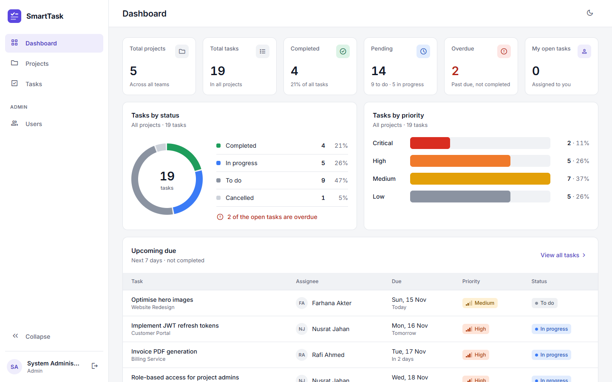 | 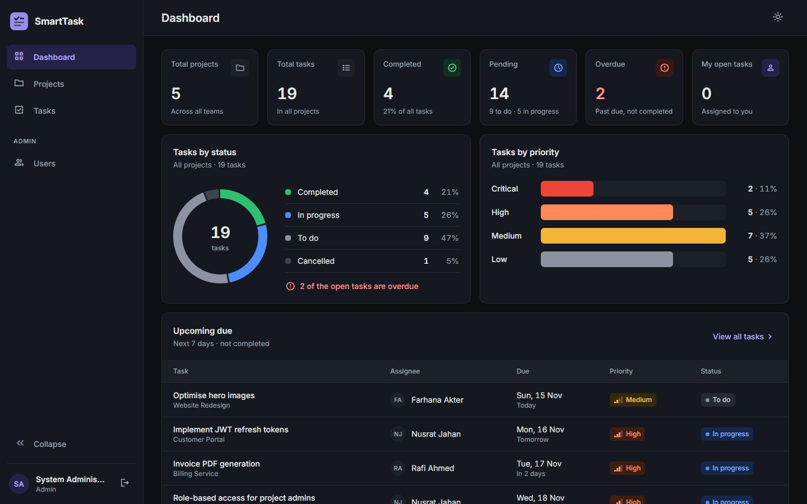 |
| Tasks | 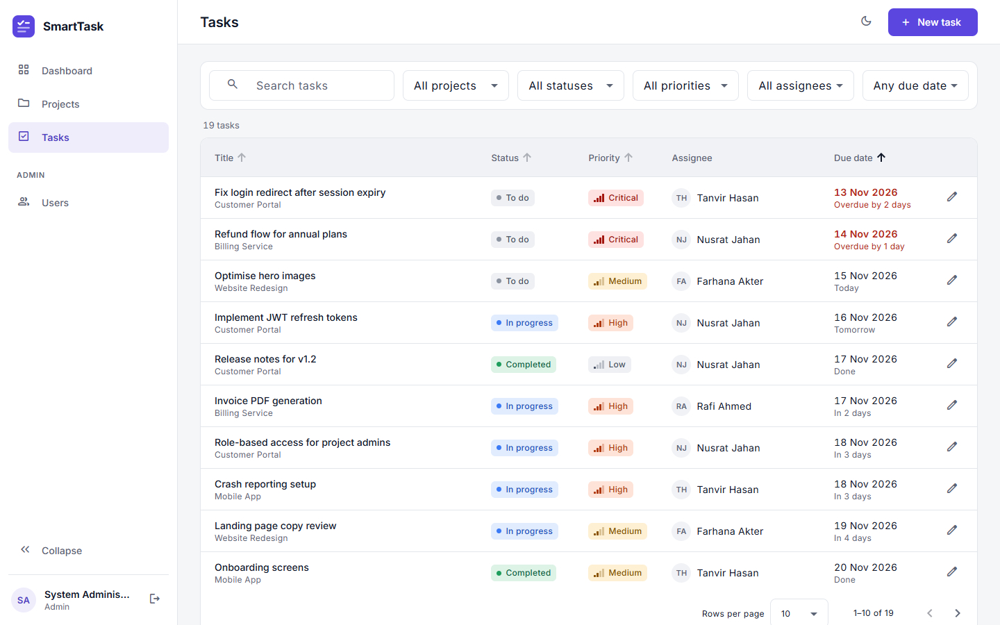 | 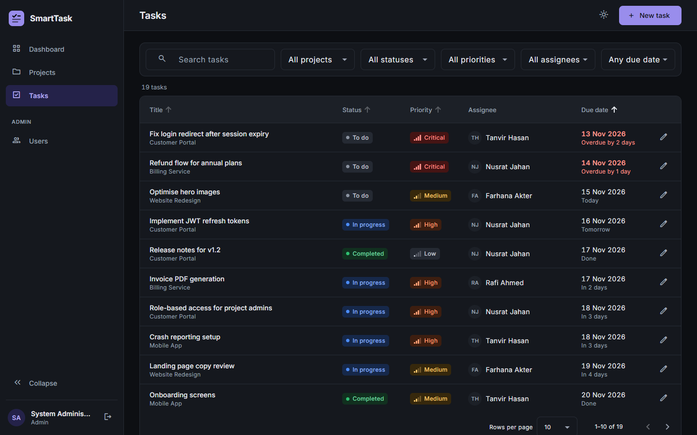 |
| Task dialog with Improve with AI | 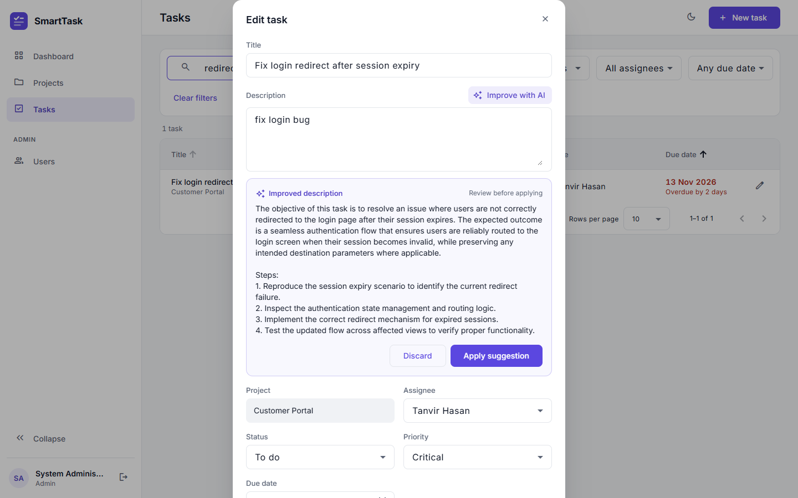 | 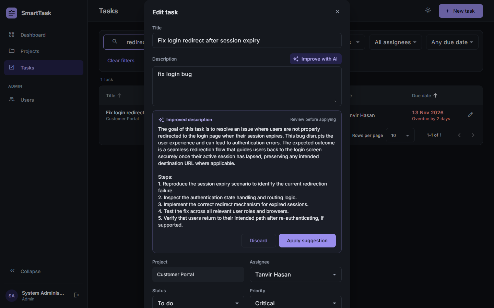 |
| Project details | 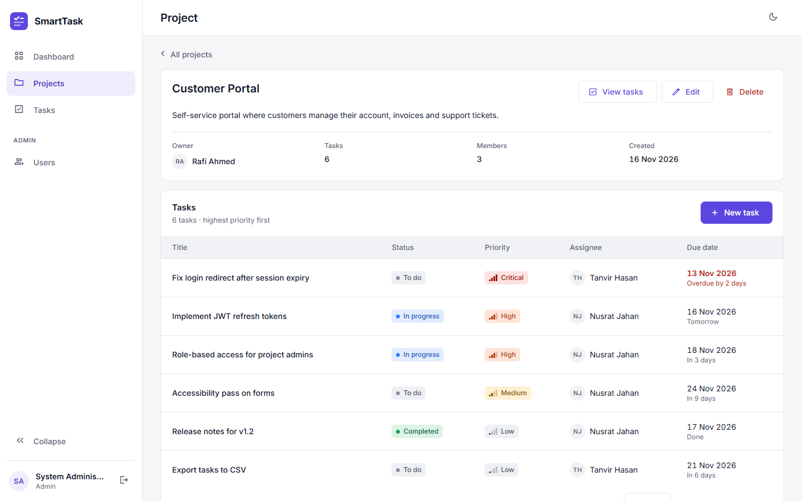 | 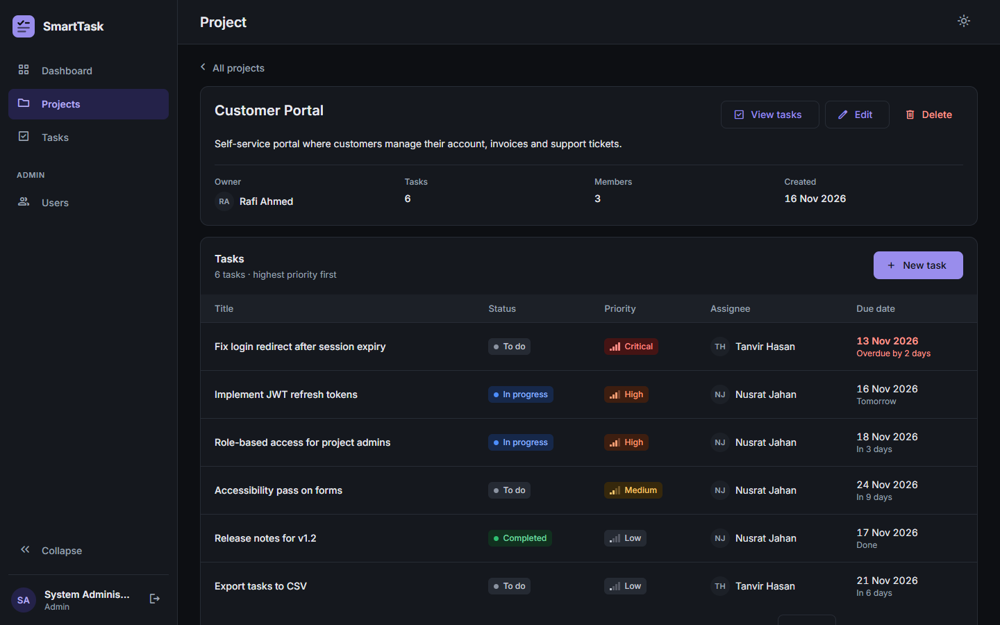 |
| Projects | 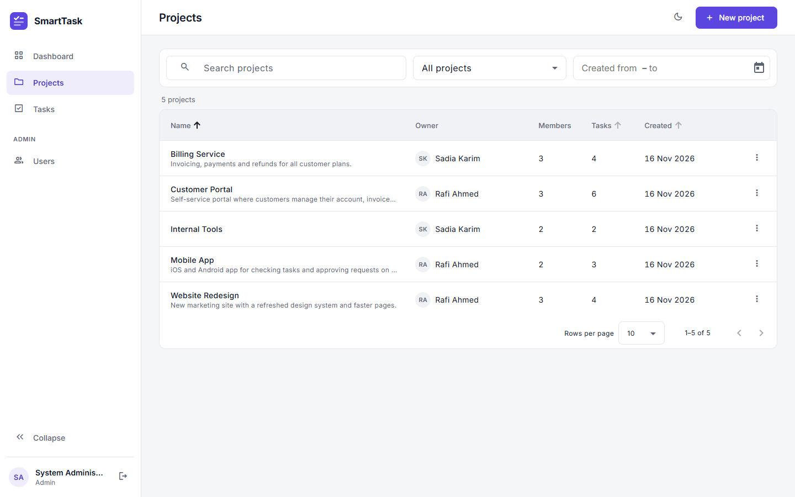 | 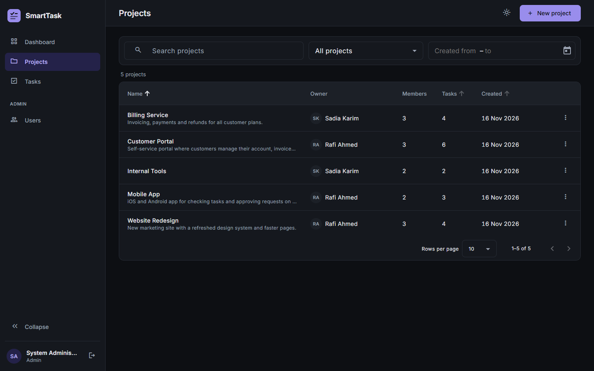 |
| Users (Admin) | 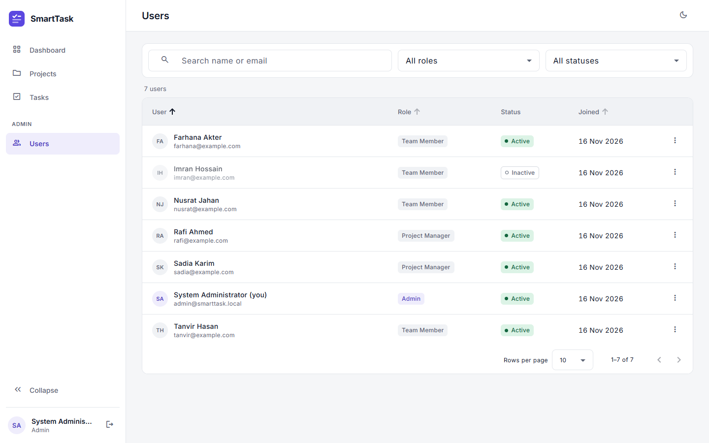 | 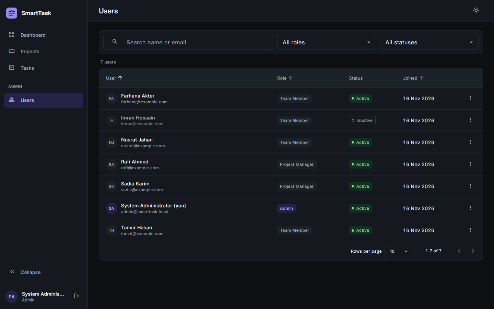 |
| Sign in | 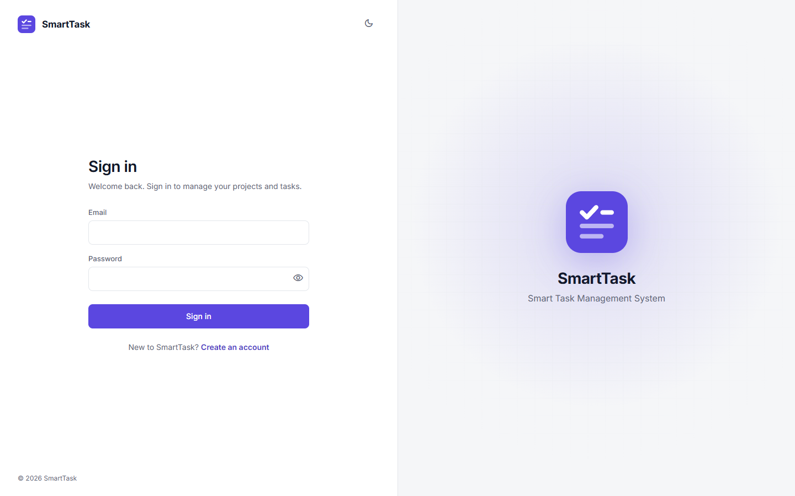 | 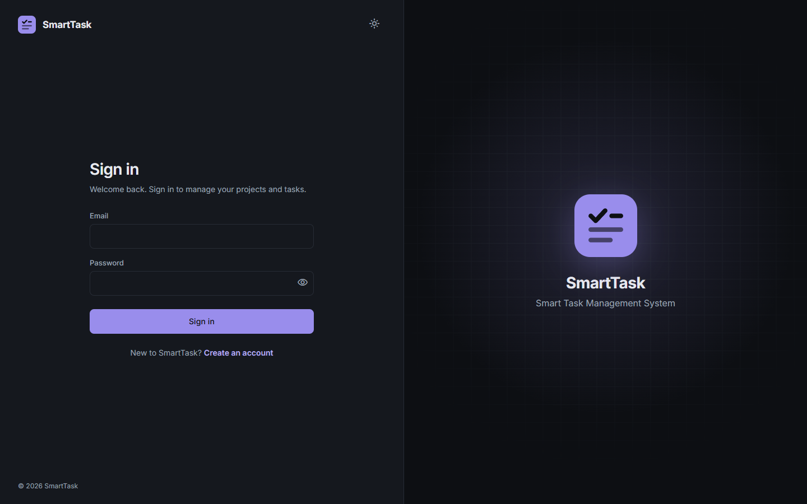 |

On a phone, lists become cards and the sidebar becomes a drawer:

<p>
  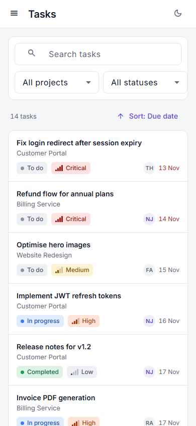
  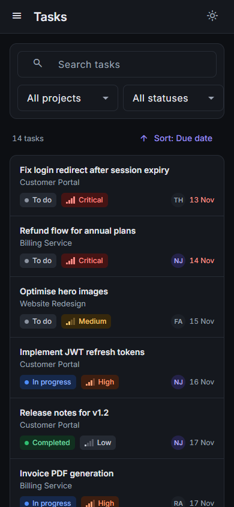
</p>

## Features by role

Every user has exactly one role. Anyone can create an account; new accounts are always Team Members, and an Admin can change roles.

| Feature | Admin | Project Manager | Team Member |
|---|---|---|---|
| Sign in, sign out, stay signed in across reloads | ✓ | ✓ | ✓ |
| Dashboard: totals, tasks by status and priority, overdue, upcoming due, my open tasks | All projects | Their projects | Their projects |
| See projects and their tasks | All | Owned or member of | Member of |
| Create projects | ✓ | ✓ | |
| Edit and delete projects, add and remove members | Any project | Projects they own | |
| Create, edit, assign and delete tasks | Any project | Projects they own | |
| Change a task's status | Any task | Tasks in projects they own, and tasks assigned to them | Tasks assigned to them |
| Reopen a cancelled task | ✓ | Projects they own | |
| Improve a description with AI | ✓ | ✓ (where they can edit) | |
| Manage users: change role, activate, deactivate | ✓ | | |

The interface only shows the actions a user can perform, and the API enforces the same rules. A project or task you are not allowed to see returns 404, not 403, so its existence is not revealed.

**Lists** (projects, tasks, users) support keyword search, filters, sorting and paging. The filters are kept in the URL, so reloading the page or sharing a link keeps them.

**Tasks** have four statuses (To do, In progress, Completed, Cancelled) and four priorities (Low, Medium, High, Critical). Moving a task to Completed records when it was completed. A cancelled task can only be reopened (back to To do) by the project owner or an Admin.

## Tech stack

| Area | Technology | Version |
|---|---|---|
| Backend runtime | .NET SDK / ASP.NET Core | 10 (SDK pinned to 10.0.100 or a later feature band by `global.json`) |
| Language | C# | 14 |
| Data access | Entity Framework Core (SQL Server provider) | 10.0.15 |
| Database | SQL Server 2019 LocalDB or newer (compatibility level 150) | |
| Authentication | JWT bearer (Microsoft.AspNetCore.Authentication.JwtBearer) | 10.0.15 |
| Validation | FluentValidation | 12.2.0 |
| Logging | Serilog.AspNetCore, Serilog.Sinks.File | 10.0.0, 7.0.0 |
| API documentation | Swashbuckle.AspNetCore (Swagger UI and CLI) | 10.3.1 |
| AI client | OpenAI .NET SDK, against Gemini's OpenAI-compatible endpoint | 2.14.0 |
| AI model | Google Gemini `gemini-3.5-flash-lite` | |
| Frontend | Angular (standalone components, signals, zoneless) | 22.2 |
| UI components | Angular Material (Material 3) | 22.2 |
| Frontend language | TypeScript | 6.0 |
| Tooling | dotnet-ef 10.0.15, Swashbuckle CLI 10.3.1 (local tools in `dotnet-tools.json`), Node.js and npm | |

Package versions are managed centrally in `Directory.Packages.props`.

## Prerequisites

- **.NET 10 SDK**. `global.json` pins it (10.0.100, rolling forward to later feature bands).
- **SQL Server 2019 LocalDB or newer**. LocalDB comes with Visual Studio or the SQL Server Express installer. The setup script creates and starts the `MSSQLLocalDB` instance if needed. Any SQL Server 2019+ instance also works if you set the connection string.
- **Node.js and npm**. Angular 22 needs Node `^22.22.3`, `^24.15.0` or `>=26.0.0`.
- **PowerShell**. Windows PowerShell 5.1 or PowerShell 7, for the setup and check scripts.
- Optional: a **Google Gemini API key** for the AI feature. Without one, an offline fallback is used.

## Quick start

From the repository root:

```powershell
# 1. One-time setup: checks the SDK and LocalDB, restores tools, sets user-secrets,
#    trusts the HTTPS development certificate and creates the database.
./tools/setup-dev.ps1 -TrustDevCert

# Optional: add a Gemini API key now (or later with: dotnet user-secrets set AiSettings:ApiKey <key> --project src/SmartTaskManager.Api)
./tools/setup-dev.ps1 -AiApiKey <your-gemini-key>
```

`setup-dev.ps1` is safe to run again; existing secrets are kept unless you pass `-Force`. It stores these values in user-secrets, never in `appsettings.json`:

| Secret | Value |
|---|---|
| `Jwt:SigningKey` | 64 random bytes |
| `SeedAdmin:Email` | `admin@smarttask.local` (change with `-AdminEmail`) |
| `SeedAdmin:Password` | 20 random characters, **printed once at the end of the run** |
| `AiSettings:ApiKey` | Only if you pass `-AiApiKey` |

`-TrustDevCert` runs `dotnet dev-certs https --trust` (a Windows prompt appears), so the browser accepts `https://localhost:7122` without warnings.

```powershell
# 2. Run the API (https profile): https://localhost:7122
dotnet run --project src/SmartTaskManager.Api --launch-profile https
```

On first start, the API applies migrations (Development only) and creates the Admin account from the user-secrets if no Admin exists yet. Check it at:

- Swagger UI: https://localhost:7122/swagger (Development only)
- Health: https://localhost:7122/health

```powershell
# 3. Run the frontend: http://localhost:4200
cd frontend
npm install
npm start
```

The Angular dev server forwards `/api` and `/health` to the API (`frontend/proxy.conf.json`), so the browser sees one origin.

**Sign in** at http://localhost:4200 with the Admin email and the password the setup script printed. If you missed it, run `dotnet user-secrets list --project src/SmartTaskManager.Api`. Create more accounts with "Create an account" (they start as Team Members), then promote them on the Users page.

**AI key is optional.** Without `AiSettings:ApiKey`, "Improve with AI" uses an offline fallback that tidies the text and adds generic steps. The API logs which implementation is active at startup.

## Troubleshooting

- **The API pauses or "hangs" under the Visual Studio debugger.** The API uses exceptions such as `UnauthorizedException`, `NotFoundException` and `ForbiddenException` for expected outcomes, like a wrong password or a missing project. The global exception handler turns them into normal 4xx responses. If Visual Studio is set to break on these exceptions, the debugger pauses the API, and the frontend seems to hang or its session restore times out. Run without the debugger (`Ctrl+F5` or `dotnet run`), or untick these exception types (or "Break when this exception type is thrown") in **Exception Settings**.
- **"Cannot reach the server" in the app.** Start the API with the `https` profile (port 7122), because the frontend proxy targets that port.
- **Sign-in fails right after setup.** The Admin is only created when no Admin exists yet. If you re-ran setup with `-Force`, the new password only applies to a fresh database.
- **429 Too Many Requests.** Sign-in and registration allow 5 requests per minute per IP. Wait a minute.

## Architecture

Clean Architecture with four backend projects. Dependencies point inwards: Domain has no dependencies, and Application references no EF Core or ASP.NET Core.

```
Api  ──►  Application  ──►  Domain
 │             ▲
 └──►  Infrastructure ──┘
```

| Layer | Project | Responsibility |
|---|---|---|
| Domain | `SmartTaskManager.Domain` | Entities (User, RefreshToken, Project, ProjectMember, TaskItem), enums, business rules such as task status transitions |
| Application | `SmartTaskManager.Application` | Use cases as plain services, DTOs, FluentValidation validators, access rules, interfaces for persistence, tokens and AI |
| Infrastructure | `SmartTaskManager.Infrastructure` | EF Core `AppDbContext`, configurations, migrations, repositories, JWT, password hashing, AI providers, seeding |
| API | `SmartTaskManager.Api` | Thin controllers, authentication and authorization setup, middleware, error handling, rate limiting, Swagger, health checks |

### Folder structure

```
SmartTaskManager/
├── src/
│   ├── SmartTaskManager.Domain/           Common/ (base entities, soft delete), Entities/, Enums/
│   ├── SmartTaskManager.Application/      Abstractions/ (interfaces), Common/ (ApiResponse, paging, exceptions),
│   │                                      Features/{Auth,Projects,Tasks,Users,Dashboard,Ai}/
│   ├── SmartTaskManager.Infrastructure/   Persistence/ (DbContext, Configurations, Interceptors, Migrations, Seed),
│   │                                      Repositories/, Auth/ (JWT, hashing), Ai/ (Gemini client, fallback, prompts)
│   └── SmartTaskManager.Api/              Controllers/, Auth/, Authorization/, ErrorHandling/, Filters/,
│                                          RateLimiting/, Extensions/, Health/, Swagger/, Program.cs
├── frontend/                              Angular app
│   └── src/app/
│       ├── core/        api, auth, theme, notifications, forms helpers, shared models and services
│       ├── layout/      app shell (sidebar, header) and the header-action slot
│       ├── features/    auth, dashboard, projects, tasks, users, errors (one lazy-loaded route each)
│       └── shared/      avatar, badges, confirm dialog, date adapter, select sizing, logo, theme toggle
├── tools/
│   ├── setup-dev.ps1          one-time developer setup
│   ├── export-api-docs.ps1    regenerates docs/database.sql, swagger.json, Postman collection
│   └── api-checks/            end-to-end API checks (PowerShell)
└── docs/                      swagger.json, Postman collection, database.sql, screenshots, design spec
```

### Design patterns

| Pattern | Where |
|---|---|
| Clean Architecture (dependency inversion between layers) | `src/` project references; interfaces in `Application/Abstractions/`, implementations in `Infrastructure/` |
| Repository, one per aggregate (no generic repository) | `Application/Abstractions/I*Repository.cs`, `Infrastructure/Repositories/` |
| Unit of Work (the DbContext, with explicit transactions where needed) | `Application/Abstractions/IUnitOfWork.cs`, `Infrastructure/Persistence/AppDbContext.cs` |
| Service layer (plain application services, no MediatR) | `Application/Features/*/…Service.cs` |
| DTOs with manual mapping (no AutoMapper) | `Application/Features/*/…Dtos.cs`, `Users/UserMappings.cs`, projections in `ProjectAccess.cs` and `TaskAccess.cs` |
| Specification-style access rules as LINQ expressions, applied in SQL | `Application/Features/Projects/ProjectAccess.cs`, `Tasks/TaskAccess.cs` |
| Strategy, selected at startup (Gemini client or offline fallback) | `Application/Abstractions/IAiDescriptionService.cs`, `Infrastructure/Ai/`, `Infrastructure/DependencyInjection.cs` |
| Options pattern with validation at startup | `Infrastructure/Auth/JwtOptions.cs`, `Ai/AiSettings.cs`, `Api/Configuration/`, `Api/RateLimiting/RateLimitingSetup.cs` |
| Interceptors for cross-cutting persistence concerns (audit fields, soft delete) | `Infrastructure/Persistence/Interceptors/` |
| Global query filters (named soft-delete filter) | `Infrastructure/Persistence/Configurations/SoftDeleteConfiguration.cs`, `QueryFilters.cs` |
| Layer supertype (shared base entities for ids, audit fields and soft delete) | `Domain/Common/BaseEntity.cs`, `AuditableEntity.cs`, `SoftDeletableEntity.cs` |
| Rich domain model (state transitions inside the entity) | `Domain/Entities/TaskItem.cs` (status changes, `CompletedAt`), `User.cs` |
| Envelope for every response | `Application/Common/ApiResponse.cs` |
| Paged query object with whitelisted sorting | `Application/Common/Paging/` |
| Validation as an action filter (FluentValidation) | `Api/Filters/ValidationFilter.cs` |
| Central exception handler mapping exceptions to HTTP status codes | `Api/ErrorHandling/GlobalExceptionHandler.cs`, `Application/Common/Exceptions/` |
| Policy-based authorization | `Api/Authorization/Policies.cs`, `Api/Extensions/AuthExtensions.cs` |
| Adapter for the current user (HTTP context behind an interface) | `Application/Abstractions/ICurrentUser.cs`, `Api/Services/CurrentUser.cs` |
| Refresh token rotation with token families | `Infrastructure/Repositories/RefreshTokenRepository.cs`, `Application/Features/Auth/AuthService.cs` |
| Abstracted clock (`TimeProvider`) for testable dates | Services, interceptors and the dashboard |
| Frontend: services own HTTP, components stay thin; signals and resources for state; functional guards and interceptors | `frontend/src/app/core/`, `features/*/…service.ts` |

## Key decisions

- **Sessions.** Access tokens last 15 minutes and stay in the browser's memory only, never in localStorage. The refresh token lasts 7 days and lives in an httpOnly, Secure, SameSite=Strict cookie limited to `/api/auth`. It is stored only as a SHA-256 hash and replaced on every refresh. Reusing an old refresh token revokes the whole sign-in session (its token family). The frontend shares a single refresh request between parallel callers, so it never trips this check itself.
- **Role changes apply immediately.** Every request checks the token against the user's current role and active flag (one primary-key lookup). A deactivated user, or one whose role changed, gets 401; the app then refreshes and receives a token with the new role. A deactivated user cannot refresh.
- **Soft delete.** Projects and tasks are marked deleted (`IsDeleted`, `DeletedAt`, `DeletedById`) instead of being removed. Deleting a project deletes its tasks in the same transaction. Users are deactivated, not deleted; project memberships are removed for real.
- **"Today" is the UTC date.** Overdue means due before today in UTC and still To do or In progress. The API, the dashboard, the task list's overdue highlight, its captions ("Overdue by 2 days") and its due-date filters all use the same UTC date, so they always agree.
- **Rate limits.** 100 requests per minute per IP overall; 5 per minute per IP for sign-in and registration; 10 per minute per user for the AI endpoint. Refresh and logout are not under the strict limit, because the app refreshes on every page load.
- **AI provider: Google Gemini.** The assignment suggested GitHub Models, which was retired on 30 July 2026. The API calls Gemini's OpenAI-compatible endpoint with the OpenAI .NET SDK and the `gemini-3.5-flash-lite` model. See [PROMPTS.md](PROMPTS.md) for the prompt, the safety measures and why this model was chosen.
- **Assignees must be project members.** Removing a member unassigns their tasks in that project in the same save. The project owner is always a member and cannot be removed.

## API overview

All endpoints are under `/api`, except the health check. Every response, success or error, uses the same envelope:

```json
{
  "success": true,
  "data": { },
  "message": "Project created.",
  "errors": null,
  "traceId": null
}
```

On errors, `success` is false, `message` is safe to show to the user, `errors` holds validation messages by field (camelCase keys), and `traceId` links to the server log. Lists return `data` as a page: `items`, `page`, `pageSize`, `totalCount`, `totalPages`, `hasNextPage`, `hasPreviousPage`.

| Group | Endpoints | Who |
|---|---|---|
| Auth | `POST /auth/register`, `POST /auth/login`, `POST /auth/refresh`, `POST /auth/logout` | Anyone (register always creates a Team Member) |
| Projects | `GET /projects` (search, `ownerId`, `ownedByMe`, `createdFrom`/`createdTo`, sort, paging), `GET /projects/{id}` | Signed-in users, for projects they can see |
| | `POST /projects` | Admin, Project Manager |
| | `PUT /projects/{id}`, `DELETE /projects/{id}`, `POST /projects/{id}/members`, `DELETE /projects/{id}/members/{userId}` | Admin, or the owning Project Manager |
| Tasks in a project | `GET /projects/{projectId}/tasks` (search, status, priority, assignee, due range, sort, paging), `GET …/tasks/{taskId}` | Users who can see the project |
| | `POST …/tasks`, `PUT …/tasks/{taskId}`, `PUT`/`DELETE …/tasks/{taskId}/assignee`, `DELETE …/tasks/{taskId}` | Admin, or the owning Project Manager |
| | `PUT …/tasks/{taskId}/status` | Admin, the owning Project Manager, or the task's assignee |
| All tasks | `GET /tasks`: tasks across every visible project, plus `projectId` and `overdue` filters | Signed-in users |
| Dashboard | `GET /dashboard` | Signed-in users (scoped to their projects; Admin sees everything) |
| Users | `GET /users` (search, role, active), `PUT /users/{id}/role`, `PUT /users/{id}/status` | Admin (not their own role or status) |
| | `GET /users/lookup`: active users for pickers | Admin, Project Manager |
| AI | `POST /ai/improve-description`: returns a suggestion, saves nothing | Admin, Project Manager |
| Health | `GET /health` (no `/api` prefix): database check, 503 when unhealthy | Anyone |

Task and project rows include `canManage` (and, for tasks, `canUpdateStatus`), so a client can show the right actions without repeating the rules.

- Full reference: [docs/swagger.json](docs/swagger.json) (OpenAPI), or Swagger UI at `/swagger` while the API runs in Development.
- Postman: [docs/SmartTaskManager.postman_collection.json](docs/SmartTaskManager.postman_collection.json), with a `{{baseUrl}}` variable.
- Database: EF Core migrations in `src/SmartTaskManager.Infrastructure/Persistence/Migrations/`, and an idempotent script in [docs/database.sql](docs/database.sql).
- Regenerate all three with `./tools/export-api-docs.ps1`.

## Security

- **Passwords** are hashed with ASP.NET Core Identity's `PasswordHasher` (PBKDF2). Registration requires at least 8 characters with upper- and lowercase letters, a digit and a symbol.
- **Tokens:** see [Key decisions](#key-decisions). The signing key comes from user-secrets or an environment variable and is validated at startup.
- **Authorization:** policies for roles (`AdminOnly`, `AdminOrProjectManager`, and a fallback that requires a signed-in user), plus ownership and membership rules in the application services. Resources you cannot see return 404.
- **Input validation:** FluentValidation for every request body and query; whitelisted sort fields; strict enum binding; a 1 MB request body limit.
- **HTTPS** with HSTS outside Development; the refresh cookie is Secure.
- **CORS:** one named policy with configured origins and credentials.
- **Rate limiting:** see [Key decisions](#key-decisions). Rejected requests get 429 with the standard response envelope.
- **Secrets:** none in `appsettings*.json`. The JWT key, the Admin seed and the AI key come from user-secrets (development) or environment variables (`Jwt__SigningKey`, `SeedAdmin__Email`, `SeedAdmin__Password`, `AiSettings__ApiKey`).
- **Logging** with Serilog to the console and rolling files. Tokens, passwords, API keys and the text sent to the AI are never logged; AI calls log lengths and timings only.
- **Errors** never expose stack traces; the global handler returns a safe message and a trace id.

## Testing: API checks

There is no unit-test project, by design (see `CLAUDE.md`). Instead, `tools/api-checks/` holds end-to-end PowerShell checks that call the running API over HTTPS and verify responses, database state and logs. Each run builds the API into a temporary folder, creates a **throwaway database**, and drops it at the end, so your development database is never touched.

```powershell
./tools/api-checks/Run-ApiChecks.ps1                     # all suites (about 10 minutes, 436 checks)
./tools/api-checks/Run-ApiChecks.ps1 -Suite auth, tasks  # selected suites
./tools/api-checks/Run-ApiChecks.ps1 -Live               # also call the real AI provider (uses quota)
```

The suites cover authentication, users, projects, tasks, lists, the dashboard, the AI endpoint (against a local fake provider and the offline fallback), rate limits and health. Run `setup-dev.ps1` first, because the checks sign in as the seeded Admin. Details are in [tools/api-checks/README.md](tools/api-checks/README.md).

## Deployment notes

- **Configuration:** set `ConnectionStrings__DefaultConnection`, `Jwt__SigningKey`, `SeedAdmin__Email`, `SeedAdmin__Password`, `Cors__AllowedOrigins__0` and optionally `AiSettings__ApiKey` as environment variables. Outside Development, apply migrations with `docs/database.sql` (idempotent) or `dotnet ef database update`.
- **Behind a reverse proxy or load balancer, configure `ForwardedHeaders`.** Rate limits are counted per client IP. Without forwarded headers, every client appears to come from the proxy's IP and shares one budget: five sign-ins per minute for everyone. Enable `UseForwardedHeaders` with the proxy's known addresses so the real client IP is used.
- **Swagger UI** is only enabled in the Development environment.
- **Frontend:** `npm run build` writes static files to `frontend/dist/`. Serve them from the same origin as the API, or route `/api` to the API. The refresh cookie is SameSite=Strict, so the app and the API must share a site.
- Health checks at `/health` suit load balancer probes.

## Known limitations

- **No password reset or "remember me"**: there is no email service, so neither exists in the UI or the API.
- **No restore of deleted projects or tasks**: they are soft-deleted in the database, but v1 has no restore or trash endpoints.
- **Overdue is based on the UTC date**: east of UTC, a task due yesterday becomes overdue only when the UTC date changes (for example at 06:00 in UTC+6).
- **No concurrency control**: two people editing the same task at once means the last save wins.
- **No user self-service**: users cannot change their own name, email or password, and Admins cannot create, rename or delete users (registration is public; Admins change roles and active status).
- **Pickers load a bounded list**: the user lookup returns up to 50 people, and the task list's project filter loads the first 100 projects.
- **AI**: suggestions depend on the provider's availability and quota. See [PROMPTS.md](PROMPTS.md#known-limitations).

## Further documentation

- [PROMPTS.md](PROMPTS.md): AI prompt design, examples, validation and safety
- [docs/REQUIREMENTS_CHECKLIST.md](docs/REQUIREMENTS_CHECKLIST.md): every assignment requirement and where it is implemented
- [docs/design/DESIGN-SPEC.md](docs/design/DESIGN-SPEC.md): UI design specification
- [tools/api-checks/README.md](tools/api-checks/README.md): how the API checks work
- [CLAUDE.md](CLAUDE.md): project rules and the full list of decisions
